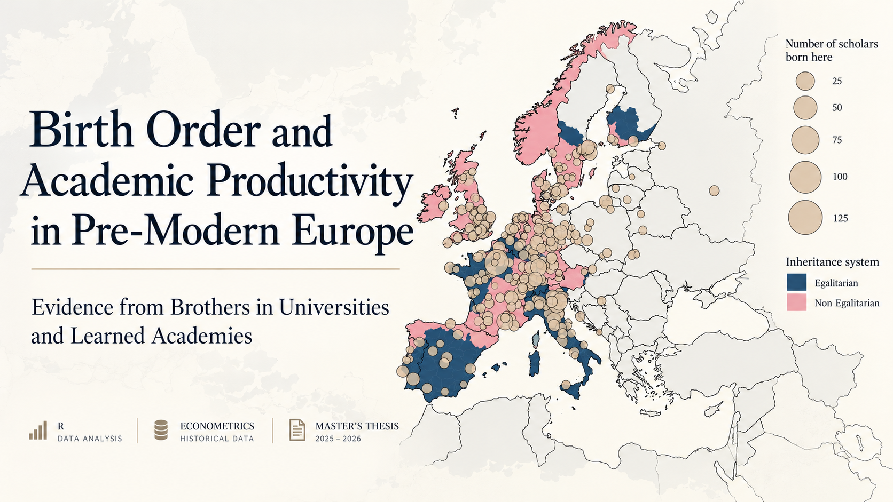

# Birth Order and Academic Productivity in Pre-Modern Europe

**Evidence from Brothers in Universities and Learned Academies**

Master's Thesis | 2025–2026

**Author:** Silvia Busquets Xapellí  
**Institutions:** UCLouvain, University of Namur and Universidade Católica Portuguesa  
**Supervisors:** Prof. David de la Croix and Prof. Hugo Reis

## Project Overview

This master's thesis examines the relationship between birth order and scholarly productivity among European scholars from the 13th to the 18th century.

Using a historical dataset of 645 brother pairs from the Repertorium Eruditorum Totius Europae (RETE), the study compares the academic productivity of older and younger brothers within families.

Scholarly productivity is measured using bibliographic indicators from the Virtual International Authority File (VIAF), complemented by measures of academic visibility from Wikipedia and Wikidata.

## Research Questions

- Were older brothers more academically productive than their younger siblings?
- Were birth-order differences primarily associated with having recorded publications or with productivity conditional on publishing?
- How were differences in academic institutions, sibling age gaps and regional inheritance systems associated with productivity gaps?
- Did these relationships vary across historical periods?

## Empirical Methodology

The empirical analysis was conducted in R and includes:

- **Descriptive statistics and data visualization** to examine historical productivity patterns.
- **Paired t-tests** comparing academic outcomes between older and younger brothers.
- **OLS regressions** estimating within-family productivity differences.
- **Logistic regression** examining the extensive margin of scholarly productivity (having at least one recorded publication).
- **OLS regression** examining the intensive margin (productivity conditional on publishing).
- **Inverse hyperbolic sine (asinh) transformation** to accommodate highly skewed productivity distributions and zero values.
- **Historical and institutional analysis** incorporating century indicators, institutional differences, regional inheritance systems and interaction specifications.
- **Robustness checks** using alternative productivity transformations and model specifications.

The empirical approach relies on comparisons between siblings within the same family. The analysis identifies statistical associations and does not establish causal effects.

## Key Findings

- Older brothers display a modest academic productivity advantage, averaging approximately 2.1 more VIAF titles than younger brothers.
- Older brothers have approximately 27% higher odds of having at least one recorded publication, based on the extensive-margin logit specification.
- Conditional on having published, productivity differences between older and younger brothers are smaller and statistically insignificant.
- Differences in institutional affiliation are more consistently associated with productivity gaps than regional inheritance systems.
- The relationships vary across historical periods, highlighting the importance of historical context.

## Tools and Skills

- **R / RStudio:** Data processing, statistical analysis and econometric modelling.
- **Econometrics:** OLS, logistic regression, paired comparisons, interaction models and robustness checks.
- **Data Analysis:** Historical data, bibliometric indicators and data visualization.
- **LaTeX / Overleaf:** Academic writing, statistical tables and documentation.
- **Beamer:** Research presentation and communication.

## Repository Structure

- `R/` — R code used for the empirical analysis.
- `thesis/` — Master's thesis and LaTeX source files.
- `presentation/` — Master's thesis defense presentation.

## Data Availability

The underlying historical dataset is not publicly available due to access restrictions.

The repository documents the research methodology and analysis workflow. Reproducing the empirical results requires authorized access to the original data.

## Academic Context

This thesis was completed as part of a joint master's degree involving UCLouvain, the University of Namur and Universidade Católica Portuguesa.

**Thesis defended:** October 2026.
